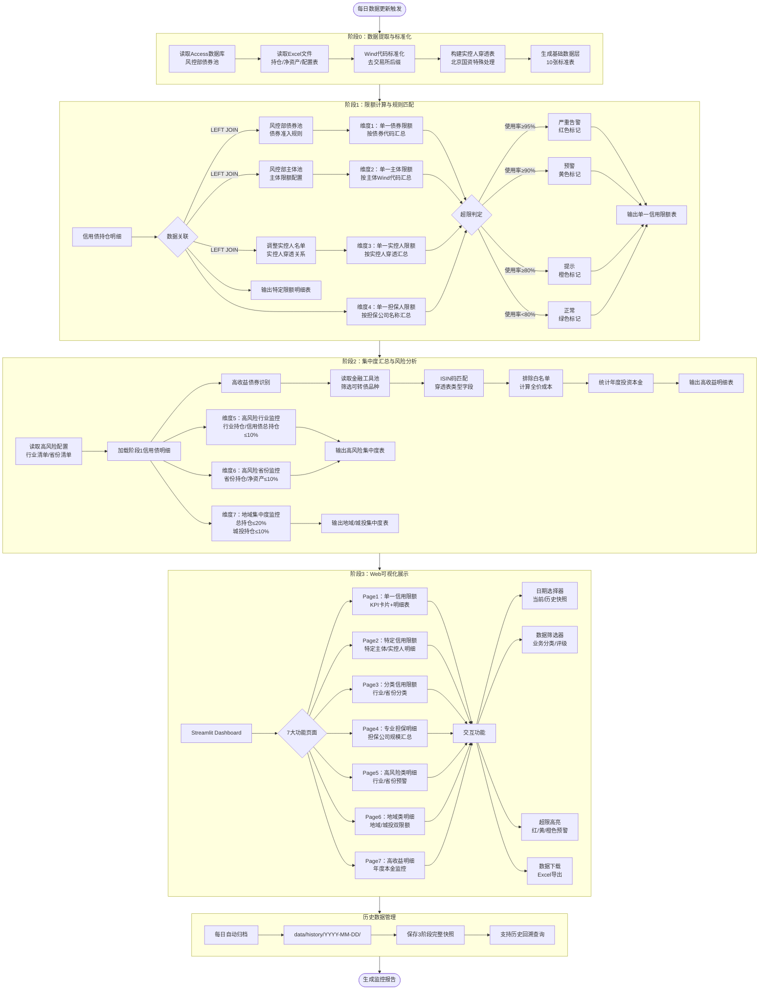

# 投后限额监控 Dashboard 业务逻辑梳理

> 面向投研/风控汇报，梳理数据输入→规则匹配→计算→预警→展示的完整业务闭环。

---

## 一、业务流程分阶段说明

### 阶段0：数据提取与预处理

**目标**：从多源异构系统拉取基础数据，完成标准化与映射。

**主要动作**：
- **数据源读取**：Access 数据库（风控部债券池）、Excel（持仓、净资产、配置表）
- **代码标准化**：债券代码 Wind 化（去除交易所后缀 .SH / .SZ / .IB）
- **主体穿透**：构建实控人穿透表、北京国有资本单独处理
- **基准数据**：公司净资产日度、债券池日期校验
- **输出物**：10 张标准化基础表，供阶段 1/2 使用

---

### 阶段1：限额计算与规则匹配

**目标**：按 4 大单一信用维度算限额使用率，识别超限。

**核心逻辑**：

#### 1.1 数据关联
```
债券持仓明细（核算系统）
  ← LEFT JOIN → 风控部债券池（准入规则）
  ← LEFT JOIN → 风控部主体池（主体限额）
  ← LEFT JOIN → 调整实控人名单（实控人穿透）
```

#### 1.2 限额维度计算
- **单一债券**：按主证券代码汇总持仓 vs 债券池配置限额
- **单一主体**：按债务主体 Wind 代码汇总 vs 主体池配置限额
- **单一实控人**：穿透至最终控制人汇总 vs 实控人限额（北京国资单独核算）
- **单一担保人**：按授信担保公司名称汇总 vs 4 亿元固定限额

#### 1.3 超限判定
- 限额使用率 = 当前持仓 / 配置限额
- 分级：≥95% 严重告警、≥90% 预警、≥80% 提示

#### 1.4 特定限额明细
- 输出特定主体、特定实控人的明细持仓
- 支持白名单豁免

**输出物**：单一信用限额监控表、特定信用限额明细表

---

### 阶段2：集中度汇总与风险分析

**目标**：计算行业/地域集中度，监控高风险敞口与高收益债券投资。

**核心逻辑**：

#### 2.1 高风险行业监控
- **识别**：从配置表读取高风险行业清单
- **公式**：高风险行业持仓合计 / 信用债总持仓 ≤ 10%
- **基准**：信用债总持仓（动态计算）

#### 2.2 高风险省份监控
- **识别**：从配置表读取高风险省份清单
- **公式**：高风险省份持仓合计 / 公司净资产 ≤ 10%
- **基准**：公司净资产（从净资产日度表取）

#### 2.3 地域集中度限额
- **单一地域总持仓**：按省份汇总 / 公司净资产 ≤ 20%
- **单一地域城投持仓**：按省份筛选城投债 / 公司净资产 ≤ 10%
- **省份标准化**：统一“省/市/自治区”等后缀

#### 2.4 高收益债券投资本金规模
- **穿透识别**：金融工具池（可转债）→ ISIN 匹配穿透表“类型” → 排除白名单
- **全价成本**：历史建仓成本 × 持仓数量
- **年度监控**：当年累计投资本金

**输出物**：高风险集中度表、地域集中度表、城投集中度表、高收益明细表

---

### 阶段3：可视化展示与交互

**目标**：Web Dashboard 实时展示，支持历史回溯与穿透。

**展示维度**：
1. **单一信用限额**：债券/主体/实控人/担保人总览（KPI 卡片 + 明细表）
2. **特定信用限额**：特定主体与实控人穿透明细
3. **分类信用限额**：按行业/省份/地域分类
4. **专业担保明细**：授信担保公司规模汇总
5. **高风险类明细**：高风险行业与省份超限预警
6. **地域类明细**：地域与城投双限额监控
7. **高收益明细**：年度高收益债券投资本金

**交互**：日期选择（当前/历史快照）、筛选（业务分类/评级/新老划断）、超限高亮、Excel 导出

---

## 二、限额监控核心逻辑要点（7 大维度）

### 1. 单一债券规模限额
- **监控对象**：单只债券持仓规模
- **限额来源**：风控部债券池配置表（按债券代码）
- **计算**：按主证券代码汇总各账户持仓 vs 债券池限额
- **风控要点**：防止单券集中度过高

### 2. 单一主体规模限额
- **监控对象**：同一发行主体全部债券持仓合计
- **限额来源**：风控部主体池配置表（按主体 Wind 代码）
- **计算**：按债务主体 Wind 代码汇总 vs 主体限额
- **风控要点**：控制同一债务主体集中风险

### 3. 单一实控人规模限额
- **监控对象**：同一实际控制人下所有主体的债券持仓
- **限额来源**：调整实控人名单（多业务线取最高限额）
- **计算**：按“调整后实际控制人”穿透汇总 vs 实控人限额；**北京国有资本单独核算**
- **风控要点**：集团层面穿透，防范隐性集中

### 4. 单一担保人规模限额
- **监控对象**：同一担保公司担保的债券持仓合计
- **限额来源**：固定 4 亿元（做市 + 自营）
- **计算**：按“授信担保公司名称”汇总 vs 4 亿元
- **风控要点**：控制担保链风险

### 5. 高风险行业集中度
- **监控对象**：高风险行业持仓占信用债比例
- **限额**：高风险行业持仓合计 / 信用债总持仓 ≤ 10%
- **行业清单**：配置表动态读取
- **风控要点**：控制周期性、过剩产能等行业敞口

### 6. 高风险省份集中度
- **监控对象**：高风险省份持仓占净资产比例
- **限额**：高风险省份持仓合计 / 公司净资产 ≤ 10%
- **省份清单**：配置表动态读取
- **风控要点**：控制区域系统性风险

### 7. 地域集中度限额（双重）
- **监控 A**：单一省份总持仓 / 公司净资产 ≤ 20%
- **监控 B**：单一省份城投债持仓 / 公司净资产 ≤ 10%
- **风控要点**：既控区域总敞口，又单独控城投风险

---

## 三、完整业务流程图（Mermaid）



---

## 四、关键风控逻辑补充

### 穿透计算原则
- **债券 → 主体**：通过“债务主体 Wind 代码”关联
- **主体 → 实控人**：通过“调整后实际控制人”穿透
- **北京国资**：单独核算，不与其他北京市属合并

### 限额配置与白名单
- 限额从 `config/limits.yaml` 及配置表读取，支持按业务线差异化
- 白名单：特批债券/主体可豁免限额约束

### 数据一致性
- 逻辑对标 Excel Power Query M 代码
- 中间计算保留完整精度，仅展示时格式化
- 变更后运行验证脚本与 Power BI 参考数据对比

### 预警分级
| 级别   | 使用率   | 颜色 | 动作建议       |
|--------|----------|------|----------------|
| 严重   | ≥ 95%    | 红   | 立即处置、禁止新增 |
| 预警   | ≥ 90%    | 黄   | 审慎审批、控制加仓 |
| 提示   | ≥ 80%    | 橙   | 关注、提前减仓或分散 |
| 正常   | < 80%    | 绿   | 常规监控         |

---

**文档用途**：投研/风控汇报、新人培训、监管与内审说明。  
**最后更新**：与当前代码逻辑一致，如有规则变更请同步更新本文档。
